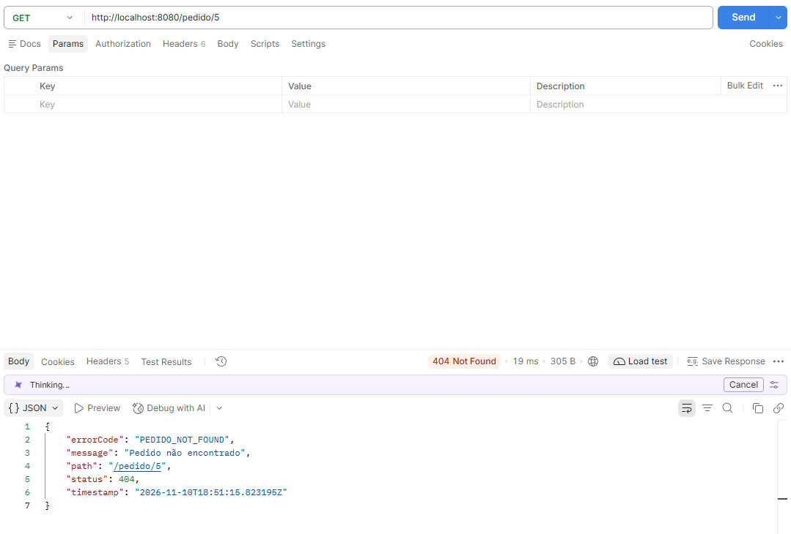
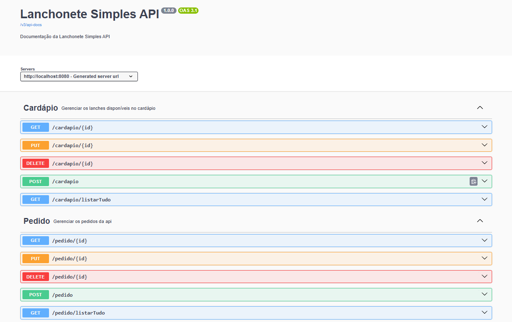
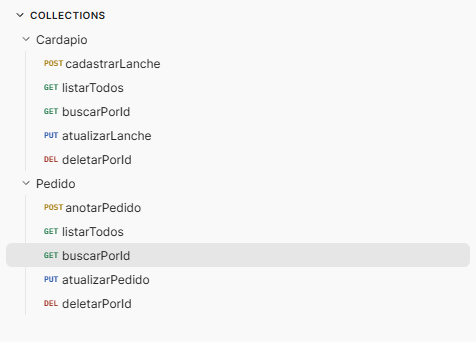

# 🍔 API Lanchonete

API REST para gerenciar o cardápio e os pedidos de uma lanchonete, desenvolvida com **Java, Spring Boot e MySQL**. O projeto permite cadastrar lanches, registrar pedidos e calcular automaticamente o total a partir do preço do lanche e da quantidade solicitada.

Projeto de estudo e prática de desenvolvimento back-end, com organização em camadas, persistência com Spring Data JPA, DTOs com Java Records e documentação interativa com Swagger UI.


## Sumário

- [Funcionalidades](#funcionalidades)
- [Tecnologias](#tecnologias)
- [Organização do projeto](#organização-do-projeto)
- [Modelo de dados e regras de negócio](#modelo-de-dados-e-regras-de-negócio)
- [Como executar](#como-executar)
- [Como usar o Swagger](#como-usar-o-swagger)
- [Endpoints](#endpoints)
- [Exemplos de requisição e resposta](#exemplos-de-requisição-e-resposta)
- [Validações e erros](#validações-e-erros)
- [Como testar no Postman](#como-testar-no-postman)
- [Build e testes](#build-e-testes)
- [Capturas de tela](#capturas-de-tela)
- [Solução de problemas](#solução-de-problemas)
- [Estado atual e possíveis melhorias](#estado-atual-e-possíveis-melhorias)
- [Autor](#autor)

## Funcionalidades

- Cadastro, listagem, consulta por ID, atualização e exclusão de lanches.
- Registro, listagem, consulta por ID, atualização e exclusão de pedidos.
- Associação de cada pedido a um lanche cadastrado no cardápio.
- Cálculo automático do total do pedido usando `BigDecimal`.
- Validação dos dados de entrada dos pedidos.
- Resposta personalizada para recursos não encontrados.
- Logs das operações na camada de serviço.
- Documentação e execução de requisições pelo Swagger UI.

## Tecnologias

| Tecnologia | Utilização |
| --- | --- |
| Java 21 | Linguagem e versão configurada no projeto |
| Spring Boot 4.1.2 | Inicialização e configuração da aplicação |
| Spring Web MVC | Controllers e endpoints HTTP |
| Spring Data JPA / Hibernate | Persistência e mapeamento objeto-relacional |
| MySQL / MySQL Connector/J | Banco de dados e driver JDBC |
| Jakarta Bean Validation | Restrições nos DTOs de entrada |
| Lombok | Geração de métodos e integração com logs via `@Slf4j` |
| springdoc-openapi 3.2.0 | Geração da especificação OpenAPI e Swagger UI |
| Maven / Maven Wrapper | Dependências, execução, testes e empacotamento |
| Spring Boot DevTools | Recursos de apoio ao desenvolvimento |

As versões explícitas acima correspondem ao `pom.xml`. As demais dependências são gerenciadas pelo Spring Boot.

## Organização do projeto

O pacote principal é `com.br.lanchonete.api_lanchonete`.

| Pacote ou arquivo | Responsabilidade |
| --- | --- |
| `controller` | Receber requisições HTTP e encaminhá-las aos serviços |
| `service` | Executar as operações e regras de negócio, incluindo o cálculo do total |
| `repository` | Acessar o banco com Spring Data JPA |
| `model` | Representar as entidades `Cardapio` e `Pedido` |
| `dto/cardapio` | Definir os contratos de entrada e saída do cardápio |
| `dto/pedido` | Definir os contratos de entrada e saída dos pedidos |
| `dto/exception` | Representar a resposta de erro personalizada |
| `exceptions` | Declarar a exceção de recurso não encontrado e seu tratamento global |
| `swagger` | Configurar título, descrição e versão da documentação OpenAPI |
| `src/main/resources/application.properties` | Configurar a aplicação e a conexão com o banco |
| `src/test` | Conter os testes automatizados |

Os controllers delegam as operações aos services, que utilizam os repositories para acessar o MySQL. Os DTOs de requisição e resposta são declarados como records. Atualmente, `PedidoResponse` inclui o objeto `Cardapio` no campo `lanche`.

## Modelo de dados e regras de negócio

### Cardápio

| Campo | Tipo Java | Descrição |
| --- | --- | --- |
| `id` | `Short` | Identificador gerado pelo banco |
| `nomeLanche` | `String` | Nome do lanche; coluna obrigatória com até 40 caracteres |
| `descricao` | `String` | Descrição; coluna de até 200 caracteres |
| `valor` | `BigDecimal` | Preço unitário; coluna obrigatória |

### Pedido

| Campo | Tipo Java | Descrição |
| --- | --- | --- |
| `id` | `Integer` | Identificador gerado pelo banco |
| `nomeCliente` | `String` | Nome do cliente; coluna obrigatória com até 50 caracteres |
| `lanche` | `Cardapio` | Lanche associado por relacionamento `@ManyToOne` |
| `quantidade` | `Integer` | Quantidade solicitada |
| `totalPedido` | `BigDecimal` | Total calculado pela aplicação |

Vários pedidos podem utilizar o mesmo lanche. Cada pedido contém **um tipo de lanche e sua quantidade**, e não uma lista de itens diferentes. O nome do cliente é armazenado diretamente no pedido; não há uma entidade de cliente separada.

O cálculo realizado no cadastro e na atualização do pedido é:

```text
totalPedido = valor do lanche × quantidade
```

Por exemplo, um lanche de R$ 18,50 com quantidade 2 gera um total de R$ 37,00. O cliente da API envia `lancheId` e `quantidade`; não precisa enviar `totalPedido`.

O total é persistido no pedido. Alterar o preço no cardápio não recalcula automaticamente os pedidos existentes. Ao atualizar um pedido, o total é calculado novamente com o preço atual do lanche escolhido.

## Como executar

### 1. Pré-requisitos

- JDK 21 instalado e configurado em `JAVA_HOME`.
- MySQL em execução e um usuário com acesso ao banco da aplicação.
- Git para clonar o repositório.
- Acesso à internet na primeira execução para baixar as dependências Maven.
- Navegador para utilizar o Swagger UI. Postman é opcional.

O repositório inclui o Maven Wrapper, portanto não é necessário instalar o Maven separadamente.

### 2. Clonar o repositório

```bash
git clone https://github.com/luis-miguel-cassoni-prof/api-lanchonete.git
cd api-lanchonete
```

### 3. Criar o banco

No MySQL Workbench ou em outro cliente SQL, execute:

```sql
CREATE DATABASE IF NOT EXISTS lanchonete
    CHARACTER SET utf8mb4;
```

O projeto utiliza `spring.jpa.hibernate.ddl-auto=update`: o Hibernate cria ou atualiza as tabelas conforme as entidades. O banco `lanchonete` deve existir antes de iniciar a aplicação. Essa configuração não substitui uma estratégia de migrações para produção.

### 4. Configurar as variáveis de ambiente

O `application.properties` já utiliza variáveis para a conexão:

```properties
spring.application.name=api-lanchonete

spring.datasource.url=${DB_URL}
spring.datasource.username=${DB_USERNAME}
spring.datasource.password=${DB_PASSWORD}
spring.datasource.driver-class-name=com.mysql.cj.jdbc.Driver

spring.jpa.hibernate.ddl-auto=update
spring.jpa.show-sql=true
```

| Variável | Exemplo | Finalidade |
| --- | --- | --- |
| `DB_URL` | `jdbc:mysql://localhost:3306/lanchonete?serverTimezone=UTC` | URL JDBC do banco |
| `DB_USERNAME` | `seu_usuario` | Usuário MySQL com acesso ao banco |
| `DB_PASSWORD` | `sua_senha` | Senha desse usuário |

Substitua os valores de exemplo pelas credenciais do seu ambiente. Não publique credenciais reais no repositório.

**Windows — PowerShell**

```powershell
$env:DB_URL = 'jdbc:mysql://localhost:3306/lanchonete?serverTimezone=UTC'
$env:DB_USERNAME = 'seu_usuario'
$env:DB_PASSWORD = 'sua_senha'

.\mvnw.cmd spring-boot:run
```

**Linux / macOS — Bash**

```bash
export DB_URL='jdbc:mysql://localhost:3306/lanchonete?serverTimezone=UTC'
export DB_USERNAME='seu_usuario'
export DB_PASSWORD='sua_senha'

chmod +x mvnw
./mvnw spring-boot:run
```

Essas definições valem para a sessão do terminal. Execute a aplicação no mesmo terminal em que configurou as variáveis.

Para executar pela IDE, configure as três variáveis na configuração de execução de `ApiLanchoneteApplication`. Criar apenas um arquivo `.env` não é suficiente: o projeto não possui um carregador de `.env` configurado.

### 5. Acessar a aplicação

Com a inicialização concluída, os endereços locais são:

| Recurso | Endereço |
| --- | --- |
| URL base da API | `http://localhost:8080` |
| Swagger UI | [http://localhost:8080/swagger-ui/index.html](http://localhost:8080/swagger-ui/index.html) |
| Especificação OpenAPI em JSON | [http://localhost:8080/v3/api-docs](http://localhost:8080/v3/api-docs) |

A porta padrão é `8080`. Se configurar outra porta com `server.port` ou `SERVER_PORT`, ajuste os endereços usados nos exemplos.

O projeto não possui página inicial em `/`. Para testar, abra o Swagger ou um endpoint como `/cardapio/listarTudo`.

## Como usar o Swagger

O Swagger UI permite consultar os endpoints, visualizar os modelos de dados e enviar requisições diretamente pelo navegador. A aplicação e o MySQL precisam estar em execução.

### Primeiro teste: cadastrar um lanche

1. Acesse [Swagger UI](http://localhost:8080/swagger-ui/index.html).
2. Localize o grupo **Cardápio**.
3. Expanda `POST /cardapio`.
4. Clique em **Try it out**.
5. Substitua o exemplo de **Request body** por:

```json
{
  "nomeLanche": "X-Bacon",
  "descricao": "Pão, hambúrguer, queijo e bacon",
  "valor": 18.50
}
```

6. Clique em **Execute**.
7. Em **Server response**, confira o código HTTP e o **Response body**.
8. Anote o `id` retornado: ele será utilizado no pedido.

O cadastro retorna `200 OK` na implementação atual. Os IDs são gerados pelo banco e não precisam ser informados no corpo de cadastro.

### Registrar um pedido

1. Localize o grupo **Pedido**.
2. Expanda `POST /pedido` e clique em **Try it out**.
3. Envie o JSON abaixo, substituindo `lancheId` pelo ID real do lanche cadastrado:

```json
{
  "nomeCliente": "Luís Miguel",
  "lancheId": 1,
  "quantidade": 2
}
```

4. Clique em **Execute**.
5. Confira o `id` do pedido, o objeto `lanche`, a `quantidade` e o `totalPedido` na resposta.

Com o preço de R$ 18,50, a quantidade 2 resulta em `totalPedido` igual a `37.00`.

### Consultar, atualizar e excluir

| Objetivo | Como testar |
| --- | --- |
| Listar os lanches | Executar `GET /cardapio/listarTudo` |
| Listar os pedidos | Executar `GET /pedido/listarTudo` |
| Consultar um registro | Abrir o `GET /{id}` do grupo desejado e preencher o parâmetro `id` |
| Atualizar um registro | Abrir o `PUT /{id}`, preencher o ID existente e enviar todos os campos do DTO de entrada |
| Excluir um registro | Abrir o `DELETE /{id}`, preencher o ID e executar |

No Swagger, `{id}` representa um parâmetro da URL. Preencha o campo correspondente apenas com o número, sem as chaves.

Para atualizar o pedido, por exemplo, utilize `PUT /pedido/1` com:

```json
{
  "nomeCliente": "Luís Miguel",
  "lancheId": 1,
  "quantidade": 3
}
```

Substitua os IDs pelos registros existentes no seu banco. O mesmo pedido será atualizado e seu total será recalculado; com o lanche a R$ 18,50, o resultado será R$ 55,50.

As exclusões retornam `204 No Content`: a ausência de corpo na resposta é esperada. Para remover um lanche utilizado em pedidos, exclua antes os pedidos associados, evitando uma violação de chave estrangeira.

> As operações feitas pelo Swagger alteram o banco de verdade. Utilize dados de teste durante a exploração.

## Endpoints

URL base local: `http://localhost:8080`.

### Cardápio

| Método | Rota | Operação | Sucesso |
| --- | --- | --- | --- |
| `POST` | `/cardapio` | Cadastrar um lanche | `200 OK` |
| `GET` | `/cardapio/listarTudo` | Listar todos os lanches | `200 OK` |
| `GET` | `/cardapio/{id}` | Buscar um lanche por ID | `200 OK` |
| `PUT` | `/cardapio/{id}` | Atualizar um lanche existente | `200 OK` |
| `DELETE` | `/cardapio/{id}` | Excluir um lanche | `204 No Content` |

### Pedido

| Método | Rota | Operação | Sucesso |
| --- | --- | --- | --- |
| `POST` | `/pedido` | Registrar um pedido | `200 OK` |
| `GET` | `/pedido/listarTudo` | Listar todos os pedidos | `200 OK` |
| `GET` | `/pedido/{id}` | Buscar um pedido por ID | `200 OK` |
| `PUT` | `/pedido/{id}` | Atualizar um pedido existente e recalcular o total | `200 OK` |
| `DELETE` | `/pedido/{id}` | Excluir um pedido | `204 No Content` |

Os endpoints de listagem retornam arrays JSON; quando não há registros, retornam `[]`. Não há paginação nem garantia de ordenação específica implementada nas listagens.

## Exemplos de requisição e resposta

Use o cabeçalho `Content-Type: application/json` em requisições com corpo. Os IDs e valores abaixo são ilustrativos. Use ponto como separador decimal no JSON.

### Cardápio — entrada de POST e PUT

```json
{
  "nomeLanche": "X-Bacon",
  "descricao": "Pão, hambúrguer, queijo e bacon",
  "valor": 18.50
}
```

### Cardápio — resposta de um registro

```json
{
  "id": 1,
  "nomeLanche": "X-Bacon",
  "descricao": "Pão, hambúrguer, queijo e bacon",
  "valor": 18.50
}
```

### Pedido — entrada de POST e PUT

```json
{
  "nomeCliente": "Luís Miguel",
  "lancheId": 1,
  "quantidade": 2
}
```

### Pedido — resposta de um registro

```json
{
  "id": 1,
  "nomeCliente": "Luís Miguel",
  "lanche": {
    "id": 1,
    "nomeLanche": "X-Bacon",
    "descricao": "Pão, hambúrguer, queijo e bacon",
    "valor": 18.50
  },
  "quantidade": 2,
  "totalPedido": 37.00
}
```

A entrada utiliza `lancheId`, enquanto a resposta retorna os dados do lanche em `lanche`. A formatação numérica pode variar, por exemplo `37.0` e `37.00`, sem alterar o valor representado.

## Validações e erros

### Validações de pedidos

O `PedidoRequest` é validado com `@Valid` no POST e no PUT.

| Campo | Restrição |
| --- | --- |
| `nomeCliente` | Obrigatório; não pode ser vazio nem conter apenas espaços (`@NotBlank`) |
| `lancheId` | Obrigatório e maior que zero (`@NotNull`, `@Positive`) |
| `quantidade` | Obrigatória e maior que zero (`@NotNull`, `@Positive`) |

Além disso, o lanche informado deve existir. Na atualização, o pedido informado na URL também precisa existir.

Os limites de comprimento das colunas, como os 50 caracteres de `nomeCliente`, são restrições do modelo persistido; não há `@Size` correspondente no DTO atual.

### Validações de cardápio

O `CardapioRequest` declara `@NotBlank` para `nomeLanche` e `descricao`, e `@NotNull` para `valor`. Porém, os parâmetros dos métodos do `CardapioController` ainda não possuem `@Valid`, portanto essas anotações não acionam a validação de entrada nesses endpoints.

Ao testar o cardápio, envie nome e descrição preenchidos e um valor positivo. As restrições do banco continuam se aplicando, mas não equivalem a uma validação completa da requisição. Também não há restrição de positividade para `valor` no DTO atual.

### Códigos HTTP

| Código | Situação |
| --- | --- |
| `200 OK` | Cadastro, consulta, listagem ou atualização concluída |
| `204 No Content` | Exclusão concluída, sem corpo de resposta |
| `400 Bad Request` | JSON malformado, tipos incompatíveis ou falha de validação dos pedidos |
| `404 Not Found` | Lanche ou pedido não encontrado nas operações que verificam sua existência |
| `500 Internal Server Error` | Falha não tratada, como determinadas violações de integridade no banco |

### Recurso não encontrado

As exceções `NotFoundException` são tratadas por `GlobalExceptionHandler` e retornam um `ErrorResponse`. Exemplo ilustrativo:

```json
{
  "errorCode": "CARDAPIO_NOT_FOUND",
  "message": "Lanche não encontrado!",
  "status": 404,
  "timestamp": "2026-11-10T18:00:00Z",
  "path": "/cardapio/999"
}
```

Os códigos de domínio utilizados são `CARDAPIO_NOT_FOUND` e `PEDIDO_NOT_FOUND`. O timestamp é gerado no momento do erro e o path corresponde à URL requisitada.

O formato personalizado acima se aplica a `NotFoundException`. Erros de validação e de leitura do JSON ainda utilizam o tratamento padrão do framework; não há garantia de que retornem esse mesmo formato.

## Como testar no Postman

1. Crie uma coleção para o projeto.
2. Adicione uma variável `baseUrl` com o valor `http://localhost:8080`.
3. Organize as requisições em duas pastas: **Cardápio** e **Pedido**.
4. Use URLs como `{{baseUrl}}/cardapio` e `{{baseUrl}}/pedido/listarTudo`.
5. Para POST e PUT, selecione **Body → raw → JSON** e utilize os exemplos deste README.
6. Cadastre um lanche antes de registrar um pedido e utilize o ID retornado.
7. Confira o status HTTP e o corpo de cada resposta.

Também é possível gerar uma coleção a partir da especificação: com a API em execução, use **Import** no Postman e informe `http://localhost:8080/v3/api-docs`. Se a importação por URL não estiver disponível no seu ambiente, salve o JSON desse endereço e importe o arquivo.

Não há uma coleção Postman exportada incluída no repositório atualmente.

### Roteiro rápido de verificação manual

1. Cadastrar um lanche e guardar seu ID.
2. Listar o cardápio e buscar o lanche por ID.
3. Atualizar o lanche e consultar novamente.
4. Registrar um pedido usando esse lanche.
5. Conferir se o total corresponde ao preço multiplicado pela quantidade.
6. Atualizar a quantidade do pedido e conferir o mesmo ID com o novo total.
7. Enviar um pedido com quantidade zero e verificar `400`.
8. Consultar um ID inexistente e verificar `404`.
9. Excluir o pedido e depois o lanche, verificando `204` em ambos.

## Build e testes

Antes de executar, mantenha o MySQL disponível e configure as variáveis de ambiente. O teste existente carrega o contexto completo da aplicação com `@SpringBootTest`; não há um banco de testes separado configurado.

**Windows — PowerShell**

```powershell
# Executar os testes
.\mvnw.cmd test

# Gerar o JAR, incluindo a execução dos testes
.\mvnw.cmd clean package

# Executar o JAR gerado
java -jar target/api-lanchonete-0.0.1-SNAPSHOT.jar
```

**Linux / macOS**

```bash
# Executar os testes
./mvnw test

# Gerar o JAR, incluindo a execução dos testes
./mvnw clean package

# Executar o JAR gerado
java -jar target/api-lanchonete-0.0.1-SNAPSHOT.jar
```

O teste automatizado presente é `contextLoads`. Ele verifica o carregamento do contexto, mas não substitui testes das regras de negócio ou dos endpoints. Os comandos acima documentam a execução local; não representam um resultado de testes já executados.

## Capturas de tela

### Tratamento de erros

Consulta de um pedido inexistente, retornando `404 Not Found` e o código `PEDIDO_NOT_FOUND` com mensagem, caminho da requisição e timestamp.



### Swagger — visão geral dos endpoints

Documentação interativa com os endpoints de Cardápio e Pedido organizados por recurso.



### Postman — organização das requisições

Requisições de cadastro, listagem, consulta, atualização e exclusão separadas nas pastas Cardápio e Pedido.



<!-- Espaço opcional: adicione docs/images/swagger-criar-pedido.png e descomente abaixo.
### Swagger — execução de uma requisição


-->

## Solução de problemas

| Problema | O que verificar |
| --- | --- |
| Variáveis `DB_URL`, `DB_USERNAME` ou `DB_PASSWORD` não resolvidas | Defina as três variáveis no terminal ou na configuração da IDE usada para iniciar a aplicação |
| `Unknown database 'lanchonete'` | Crie o banco e confira o nome na URL JDBC |
| `Access denied for user` | Confira usuário, senha e permissões do MySQL |
| Falha de conexão / `Communications link failure` | Confira se o MySQL está em execução e se host e porta da URL JDBC estão corretos |
| Porta `8080` ocupada | Encerre a outra aplicação ou configure uma porta diferente |
| Swagger não abre | Aguarde a aplicação iniciar, confira os logs e use `/swagger-ui/index.html` na porta correta |
| Erro ao abrir `http://localhost:8080/` | A API não possui página inicial; abra o Swagger ou um endpoint válido |
| `404` ao criar ou atualizar pedido | Confira se o `lancheId` existe; no PUT, confira também o ID do pedido |
| `400` ao enviar pedido | Revise o JSON, os tipos dos campos, o nome do cliente e os valores positivos de ID e quantidade |
| Erro ao excluir um lanche associado a pedidos | Exclua primeiro os pedidos que referenciam esse lanche |
| Falha de compilação por versão Java | Confira `java -version`, `JAVA_HOME` e o JDK utilizado pelo Maven/IDE |
| `Permission denied` ao executar `mvnw` | No Linux/macOS, execute `chmod +x mvnw` |

## Estado atual e possíveis melhorias

A versão atual disponibiliza operações de CRUD para cardápio e pedidos, cálculo do total e documentação Swagger. Não possui autenticação, autorização, fila de atendimento, status de preparo ou paginação.

Possíveis evoluções, ainda não implementadas:

- Ativar a validação de entrada no controller de cardápio.
- Adicionar validações de tamanho de texto e de preço positivo.
- Padronizar as respostas de validação e de JSON inválido.
- Tratar conflitos de integridade com uma resposta específica.
- Retornar `201 Created` e o cabeçalho `Location` nos cadastros.
- Adicionar testes unitários e de integração para as operações.
- Implementar paginação e filtros nas listagens.
- Evoluir o pedido para suportar vários itens diferentes.
- Adicionar fila e acompanhamento do preparo dos pedidos.

## Autor

Desenvolvido por **Luís Miguel Cassoni**, como projeto de prática em desenvolvimento back-end Java.

[Perfil no GitHub](https://github.com/luis-miguel-cassoni-prof) · [Repositório do projeto](https://github.com/luis-miguel-cassoni-prof/api-lanchonete)
